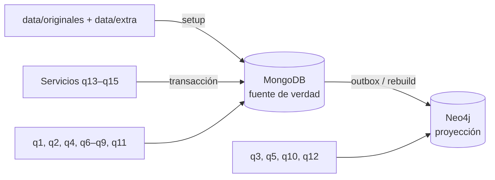

# FarmaRed — TPO Base de Datos II (2C 2026)

Backoffice de una red de farmacias con **persistencia políglota**:

- **MongoDB** (documentos) es la fuente de verdad y recibe todas las escrituras. Guarda las ventas con sus ítems embebidos y el stock por lote. Las ventas y el descuento de stock (q14 + q15) corren en una **transacción multi-documento**, sobre un replica set de un nodo.
- **Neo4j** (grafos) es una proyección de las relaciones cliente–receta–venta–farmacéutico–sucursal–producto. Responde las consultas que recorren esos caminos y se reconstruye desde MongoDB.

El informe de entrega está en [docs/FarmaRed-informe.pdf](docs/FarmaRed-informe.pdf).



## Levantar el entorno

### GitHub Codespaces (recomendado)

1. En GitHub: **Code → Codespaces → Create codespace on main**.
2. Esperar a que termine el `postCreateCommand` (2–3 minutos la primera vez). Levanta MongoDB, inicializa el replica set `rs0`, levanta Neo4j, verifica los motores con `salud` y carga los datos con `setup`.

Todo se configura en [.devcontainer/devcontainer.json](.devcontainer/devcontainer.json) y [docker-compose.yml](docker-compose.yml); no hay pasos manuales.

### Local (Docker Desktop)

Con VS Code y la extensión Dev Containers: **Reopen in Container** hace lo mismo que Codespaces.

Sin VS Code, levantá los servicios y usá el contenedor de la app:

```bash
docker compose up -d
```

```bash
docker compose exec app python -m farmared salud
```

O con Python 3.12 en el host (los puertos están publicados en `localhost`):

```bash
python3.12 -m venv .venv && source .venv/bin/activate && pip install -e .
```

```bash
python -m farmared salud
```

## Comandos

| Comando | Qué hace |
|---|---|
| `python -m farmared salud` | Verifica MongoDB (primario de `rs0`) y Neo4j |
| `python -m farmared validar-datos` | Valida los CSV (originales + extra) sin tocar ninguna base |
| `python -m farmared setup` | Carga idempotente: valida, borra y recarga MongoDB desde los CSV y reconstruye el grafo |
| `python -m farmared sync` | Proyecta en Neo4j las escrituras pendientes del outbox |
| `python -m farmared rebuild-grafo` | Borra el grafo y lo reconstruye completo desde MongoDB |
| `python -m farmared q <n>` | Ejecuta una consulta de lectura (q1–q12). Usá `--json` para salida JSON |
| `python -m farmared cliente alta`, `modificar` o `baja` | ABM de clientes (q13) |
| `python -m farmared venta registrar` | Registra una venta completada, aplica FEFO y dispensa la receta si corresponde (q14) |
| `python -m farmared stock descontar <id_venta>` | Aplica FEFO a una venta completada con stock pendiente (q15) |
| `python -m farmared informe-resultados --out <carpeta>` | Genera `q01.md` a `q15.md` con resultados y ejemplos de escritura |

### Ejemplos de q1–q15

| Consulta | Ejemplo |
|---|---|
| q1 Productos y proveedores | `python -m farmared q 1` |
| q2 Ventas pendientes | `python -m farmared q 2` |
| q3 Historial de un cliente | `python -m farmared q 3 --id-cliente C006` |
| q4 Clientes con varias recetas | `python -m farmared q 4` |
| q5 Ventas por farmacéutico | `python -m farmared q 5` |
| q6 Dispensaciones atrasadas | `python -m farmared q 6` |
| q7 Productos más vendidos | `python -m farmared q 7` |
| q8 Lotes con stock bajo | `python -m farmared q 8` |
| q9 Ventas libres de menos de $5.000 | `python -m farmared q 9` |
| q10 Clientes atendidos en una sucursal | `python -m farmared q 10 --id-sucursal S001` |
| q11 Ingresos del mes | `python -m farmared q 11` |
| q12 Clientes sin ventas en el último año | `python -m farmared q 12` |
| q13 Modificar el contacto de un cliente | `python -m farmared cliente modificar C007 --email demo@example.com` |
| q14 Registrar una venta con receta | `python -m farmared venta registrar --cliente C007 --farmaceutico F001 --item PRD003:50 --receta RC006 --pago "Obra social"` |
| q15 Rechazar un segundo descuento | `python -m farmared stock descontar V002` |

Los comandos de q13 y q14 escriben datos si tienen éxito. En la carga inicial, las ventas completadas ya tienen aplicado el stock. Para ver un descuento exitoso de q15, ejecutá el ejemplo de q14 sobre una carga fresca con `FARMARED_HOY=2026-11-13` y verificá que consuma 40 unidades de L005 y 10 de L015.

### Resultados para el informe

En un Codespace de demostración, corré estos comandos antes de probar escrituras manuales:

```bash
export FARMARED_HOY=2026-11-13
python -m farmared setup
python -m farmared informe-resultados --out docs-local/resultados
```

`setup` recarga la base configurada en MongoDB y reconstruye Neo4j desde los CSV. El generador toma q1–q12 de esas bases y ejecuta los ejemplos de escritura en una base temporal de MongoDB, que elimina al terminar. Los Markdown muestran resultados, estados antes y después, y rechazos de q13–q15. La carpeta `docs-local/` está ignorada por Git.

## Grafo y sincronización

Neo4j guarda los caminos que recorren las consultas de historial y relaciones:

```
(:Cliente)-[:REALIZO]->(:Venta)-[:ATENDIDA_POR]->(:Farmaceutico)-[:TRABAJA_EN]->(:Sucursal)
(:Cliente)-[:TIENE_RECETA]->(:Receta)<-[:DISPENSA]-(:Venta)
(:Venta)-[:INCLUYE {cantidad, precio_unit}]->(:Producto)
```

El grafo se proyecta desde MongoDB. q13 y q14 guardan sus eventos en `outbox` en la misma transacción de los datos y los proyectan después del commit. Si Neo4j no responde, `sync` reintenta los eventos pendientes y `rebuild-grafo` puede reconstruir el grafo completo. El stock se mantiene en MongoDB.

## Datos

- [data/originales/](data/originales/) tiene los 9 CSV provistos por la cátedra, sin modificar.
- [data/extra/](data/extra/) tiene los registros propios del equipo: al menos 10 por tabla, con las mismas columnas. Cubren casos borde: stock bajo, lotes vencidos y por vencer, recetas vencidas y con dispensa atrasada, clientes sin compras, ventas pendientes y anuladas, y una sucursal y un farmacéutico dados de baja.
- **Fechas relativas.** Los extra pueden usar `@hoy`, `@hoy-N`, `@hoy+N` y `@mes` (día 1 del mes actual), que se resuelven al cargar. Así las consultas que dependen de la fecha (últimos 60 días, mes actual, último año) siempre tienen datos, sin importar cuándo se corra el sistema.
- **Carga idempotente.** `setup` valida todo antes de escribir: referencias, claves únicas, enums, que el total coincida con los ítems y las reglas de recetas y ventas. Si hay errores, no toca la base. Si los datos son válidos, borra la base y la recarga en una sola transacción. Correrlo varias veces deja el mismo estado.
- **Avisos.** Algunas ventas históricas no coinciden con el estado actual: por ejemplo, V001 la atendió F004, que hoy está inactivo. Se informan y se cargan igual, porque la historia es válida.

## Configuración

Todo tiene un valor por defecto. Para cambiar algo, copiá [.env.example](.env.example) a `.env`.

| Variable | Default | Uso |
|---|---|---|
| `FARMARED_HOY` | vacío (fecha real, Buenos Aires) | Fija "hoy" en `AAAA-MM-DD` para demos y tests reproducibles |
| `NEO4J_PASSWORD` | `farmared123` | Contraseña de Neo4j |
| `MONGO_DB` | `farmared` | Nombre de la base |
| `MONGO_URI` | `mongodb://localhost:27017/?directConnection=true` | Solo desde el host; el contenedor usa `mongo:27017/?replicaSet=rs0` |

## Tests

```bash
pytest
```

Para verificar q14 con los dos motores levantados en Codespaces:

```bash
python -m farmared salud
pytest -q -rs tests/test_q14.py
```

Las pruebas de q14 cubren el descuento en dos lotes, la proyección de la venta y la receta, y el rollback de venta, receta, lotes, contadores y outbox. La suite usa `farmared_test` y fija la fecha en 2026-11-13. Neo4j Community tiene una sola base y las pruebas de integración reconstruyen su grafo. Después de las pruebas, `python -m farmared rebuild-grafo` vuelve a proyectar los datos del MongoDB configurado.

## Troubleshooting

- **`salud` dice que MongoDB no es primario:** el replica set todavía se está eligiendo. Revisá `docker compose logs mongo-init`.
- **MongoDB perdía la conexión durante los tests en Codespaces.** Reconstruimos el contenedor con **Codespaces: Rebuild Container** para aplicar el límite de 64.000 archivos abiertos del servicio `mongo`. Con el límite anterior de 1.024, `mongod` podía terminar con `TooManyFilesOpen`. En un Codespace existente, el mismo comando aplica el cambio después de actualizar el repo.
- **Neo4j tarda en arrancar:** el healthcheck espera hasta unos 3 minutos. Revisá `docker compose logs neo4j`.
- **Desde el host falla la conexión a Mongo:** la URI necesita `directConnection=true`, porque el miembro del replica set se llama `mongo` y ese nombre solo resuelve dentro de Docker.
- **¿Por qué `mongo:8.2` y no `8.0`?** `mongo:8.0` se niega a arrancar en kernels Linux 6.19–7.0.13 (SERVER-121912), y Docker Desktop usa uno de esos kernels. 8.2 arranca bien.
- **Empezar de cero:** `docker compose down -v` borra los volúmenes.
