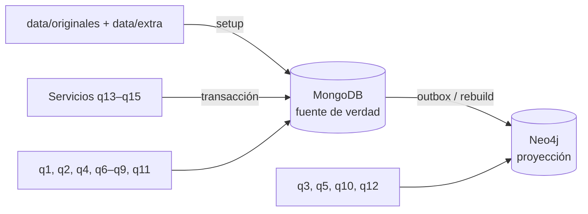

# FarmaRed — TPO Base de Datos II (2C 2026)

Backoffice de una red de farmacias con **persistencia políglota**:

- **MongoDB** (documentos) es la fuente de verdad y recibe todas las escrituras. Guarda las ventas con sus ítems embebidos y el stock por lote. Las ventas y el descuento de stock (q14 + q15) corren en una **transacción multi-documento**, sobre un replica set de un nodo.
- **Neo4j** (grafos) es una proyección de las relaciones cliente–receta–venta–farmacéutico–sucursal–producto. Responde las consultas que recorren esos caminos y se reconstruye desde MongoDB.



## Levantar el entorno

### GitHub Codespaces (recomendado)

1. En GitHub: **Code → Codespaces → Create codespace on main**.
2. Esperar a que termine el `postCreateCommand` (2–3 minutos la primera vez). Levanta MongoDB, inicializa el replica set `rs0`, levanta Neo4j y corre `python -m farmared salud`.

Todo se configura en [.devcontainer/devcontainer.json](.devcontainer/devcontainer.json) y [docker-compose.yml](docker-compose.yml); no hay pasos manuales.

### Local (Docker Desktop)

Con VS Code y la extensión Dev Containers: **Reopen in Container** hace lo mismo que Codespaces.

Sin VS Code, levantá los servicios y usá el contenedor de la app:

```bash
docker compose up -d
```

```bash
docker compose exec app python -m farmared salud
```

O con Python 3.12 en el host (los puertos están publicados en `localhost`):

```bash
python3.12 -m venv .venv && source .venv/bin/activate && pip install -e .
```

```bash
python -m farmared salud
```

## Comandos

| Comando | Qué hace |
|---|---|
| `python -m farmared salud` | Verifica MongoDB (primario de `rs0`) y Neo4j |

> En construcción: `setup` (carga idempotente), `q 1..12`, `cliente`, `venta`, `stock`.

## Configuración

Todo tiene un valor por defecto. Para cambiar algo, copiá [.env.example](.env.example) a `.env`.

| Variable | Default | Uso |
|---|---|---|
| `FARMARED_HOY` | vacío (fecha real, Buenos Aires) | Fija "hoy" en `AAAA-MM-DD` para demos y tests reproducibles |
| `NEO4J_PASSWORD` | `farmared123` | Contraseña de Neo4j |
| `MONGO_DB` | `farmared` | Nombre de la base |
| `MONGO_URI` | `mongodb://localhost:27017/?directConnection=true` | Solo desde el host; el contenedor usa `mongo:27017/?replicaSet=rs0` |

## Tests

```bash
pytest
```

## Troubleshooting

- **`salud` dice que MongoDB no es primario:** el replica set todavía se está eligiendo. Revisá `docker compose logs mongo-init`.
- **Neo4j tarda en arrancar:** el healthcheck espera hasta unos 3 minutos. Revisá `docker compose logs neo4j`.
- **Desde el host falla la conexión a Mongo:** la URI necesita `directConnection=true`, porque el miembro del replica set se llama `mongo` y ese nombre solo resuelve dentro de Docker.
- **¿Por qué `mongo:8.2` y no `8.0`?** `mongo:8.0` se niega a arrancar en kernels Linux 6.19–7.0.13 (SERVER-121912), y Docker Desktop usa uno de esos kernels. 8.2 arranca bien.
- **Empezar de cero:** `docker compose down -v` borra los volúmenes.
